# Практична робота № 11

## Автоматизоване тестування та документування API

**Виконав:** Олійник Артем Сергійович
**Курс:** IV
**Група:** КН-43
**Дисципліна:** WEB-розробка
**Варіант:** 7 (автозапчастини)
**Рік:** 2026

---

## Мета роботи

- Опанувати методологію автоматизованого тестування серверних застосунків на базі NestJS.
- Спроєктувати ізольовані модульні тести для сервісів і контролерів із мокуванням залежностей.
- Створити наскрізні інтеграційні тести з емуляцією HTTP-запитів через `supertest`.
- Зібрати метрики покриття коду та проаналізувати звіт надійності.
- Засвоїти специфікацію OpenAPI 3.0 та налаштувати генерацію інтерактивної документації через `@nestjs/swagger`.
- Задокументувати DTO, маршрути контролерів і перевірити захищені маршрути через Bearer JWT у Swagger UI.

---

## Варіант 7: каталог автозапчастин

Предметна область продовжує застосунок із практичних 7-10.

| Параметр | Значення |
|---|---|
| Модуль | `src/auto-parts` |
| Сервіс і контролер | `AutoPartsService`, `AutoPartsController` |
| Розділ Swagger | `Автозапчастини та вузли` |
| Граничний випадок валідації | OEM-код коротший за 6 символів |
| Додатковий граничний випадок | Від'ємна ціна запчастини |

---

## Середовище виконання

| Компонент | Версія |
|---|---|
| Node.js | 26.9.0 |
| npm | 11.19.1 |
| NestJS | 12.0.1 |
| `@nestjs/swagger` | 12.1.2 |
| `swagger-ui-express` | 5.0.1 |
| TypeORM | 1.1.2 |
| PostgreSQL | 16-alpine (контейнер, порт 5435) |
| Vitest | 4.1.2 |
| `@vitest/coverage-v8` | 4.1.2 |
| supertest | 7.0.0 |
| Docker | 29.9.2 |
| ОС | macOS 27.2.1 |
| Редактор | Visual Studio Code |

Проєкт продовжує стек попередніх практичних робіт, де тестовим середовищем обрано Vitest. Він надає Jest-сумісний інтерфейс (`describe`, `it`, `expect`, `vi.fn()`), тому всі тестові кейси завдання реалізовані без зміни підходу до мокування.

---

## Структура проєкту

```text
web_Practichna_11/
├── src/
│   ├── auto-parts/
│   │   ├── dto/
│   │   │   ├── create-auto-part.dto.ts
│   │   │   ├── update-auto-part.dto.ts
│   │   │   ├── create-auto-part-transactional.dto.ts
│   │   │   ├── update-auto-part-transactional.dto.ts
│   │   │   ├── pagination-query.dto.ts
│   │   │   ├── create-car-model.dto.ts
│   │   │   └── create-specification.dto.ts
│   │   ├── entities/
│   │   ├── auto-parts.controller.ts
│   │   ├── auto-parts.controller.spec.ts
│   │   ├── auto-parts.service.ts
│   │   ├── auto-parts.service.spec.ts
│   │   ├── catalog.controller.ts
│   │   ├── catalog.controller.spec.ts
│   │   ├── catalog.service.ts
│   │   └── catalog.service.spec.ts
│   ├── auth/                  JWT і ролі з практичної 9
│   ├── notifications/         Socket.IO, SSE і пошта з практичної 10
│   ├── database/              міграції та сіди
│   ├── main.ts                конфігурація Swagger
│   └── app.module.ts
├── test/
│   ├── app.e2e-spec.ts
│   └── auto-parts.e2e-spec.ts
├── coverage/lcov-report/      HTML-звіт покриття
├── screenshots/
├── docker-compose.yml         PostgreSQL 16
├── .env.example
├── vitest.config.ts
└── README.md
```

---

## Хід виконання

### Рівень 1. Модульні тести сервісу та базова інтеграція Swagger

#### Тестування сервісу

Тестовий файл `src/auto-parts/auto-parts.service.spec.ts` створює сервіс вручну й передає замість репозиторіїв об'єкти з функціями `vi.fn()`. Для зручності додано фабрику `createService()`, яка збирає сервіс із потрібною комбінацією моків:

```ts
const createService = (mocks: Partial<ServiceMocks> = {}): AutoPartsService => {
  const merged = { ...defaults, ...mocks };
  return new AutoPartsService(
    merged.autoPartsRepo as Repository<AutoPartEntity>,
    merged.carModelsRepo as Repository<CarModelEntity>,
    merged.specificationsRepo as Repository<SpecificationEntity>,
    merged.compatibilityCodesRepo as Repository<CompatibilityCodeEntity>,
    merged.dataSource as unknown as DataSource,
  );
};
```

Перевіряються обов'язкові сценарії:

- успішне створення запчастини: мок `save` викликається один раз, а результат містить збережений запис;
- пошук за коректним ID повертає сутність;
- пошук за відсутнім ID викидає `NotFoundException`;
- додатково покрито `findAll`, `findAggregate`, `update`, `remove`, `restore`, транзакційні методи та `upsertCompatibilityCode`.

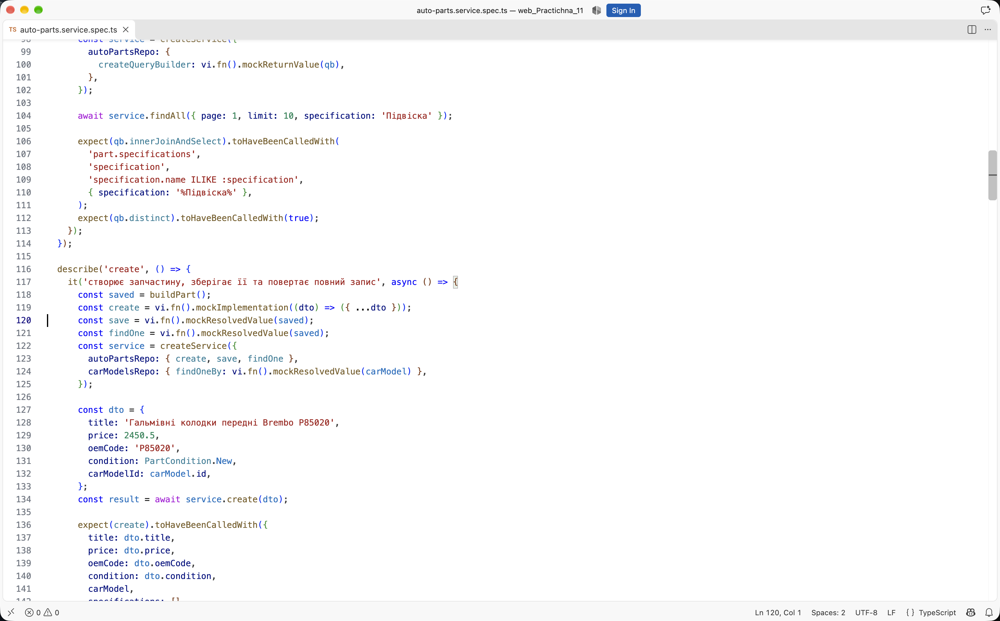

Тест успішного створення перевіряє і факт виклику репозиторію, і структуру переданих даних:

```ts
expect(create).toHaveBeenCalledWith({
  title: dto.title,
  price: dto.price,
  oemCode: dto.oemCode,
  condition: dto.condition,
  carModel,
  specifications: [],
});
expect(save).toHaveBeenCalledTimes(1);
expect(result).toEqual(saved);
```

#### Підключення Swagger

Пакети встановлено командою:

```bash
npm i @nestjs/swagger swagger-ui-express
```

У `src/main.ts` створено конфігурацію документа та підключено її до застосунку:

```ts
const swaggerConfig = new DocumentBuilder()
  .setTitle('AutoParts UA API')
  .setDescription('Офіційна технічна документація REST API онлайн-магазину автозапчастин.')
  .setVersion('1.0')
  .addBearerAuth({
    type: 'http',
    scheme: 'bearer',
    bearerFormat: 'JWT',
  })
  .addTag('Автозапчастини та вузли', 'Каталог, пошук, сумісність і CRUD-операції')
  .addTag('Довідники', 'Моделі автомобілів і вузли/агрегати')
  .addTag('Автентифікація', 'Реєстрація, вхід, оновлення токенів і профіль')
  .build();

const document = SwaggerModule.createDocument(app, swaggerConfig);
SwaggerModule.setup('api/docs', app, document, {
  jsonDocumentUrl: 'api/docs-json',
  swaggerOptions: { persistAuthorization: true },
});
```

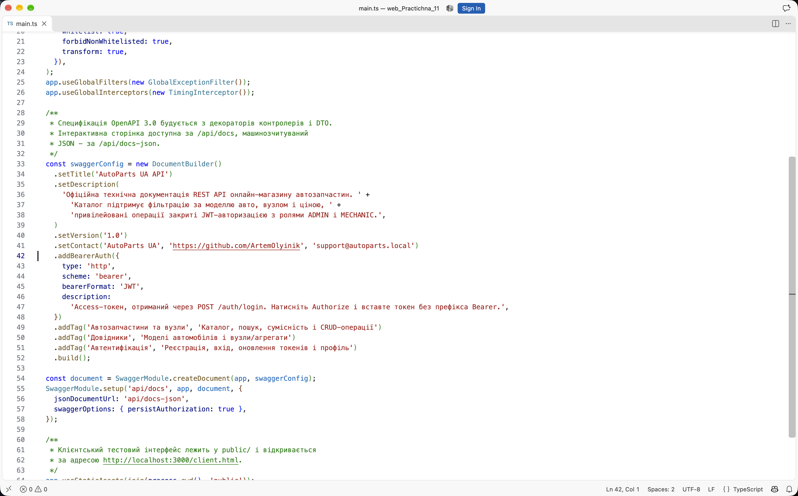

Після запуску застосунку сторінка доступна за адресою `http://localhost:3000/api/docs`. Специфікація містить 22 маршрути, згруповані за розділами.

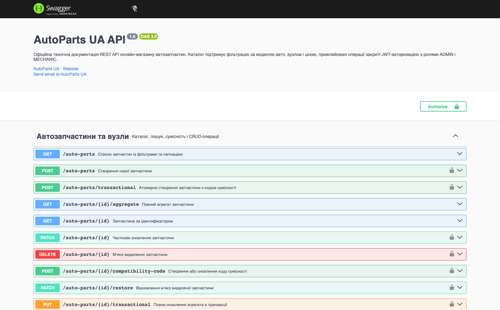

---

### Рівень 2. Тестування контролера, DTO та покриття коду

#### Тестування контролера

Для `AutoPartsController` тестовий модуль збирається через `Test.createTestingModule()`, а сервіс замінюється мок-об'єктом:

```ts
const module: TestingModule = await Test.createTestingModule({
  controllers: [AutoPartsController],
  providers: [
    { provide: AutoPartsService, useValue: service },
    { provide: RequestIdService, useValue: { getId: () => 'request-1' } },
  ],
}).compile();
```

Перевіряється делегування `findAll`, `findOne`, `findAggregate`, `create`, `createTransactional`, `update`, `updateTransactional`, `upsertCompatibilityCode`, `restore` і `remove`. Для кожного методу звіряються аргументи, які контролер передає сервісу.

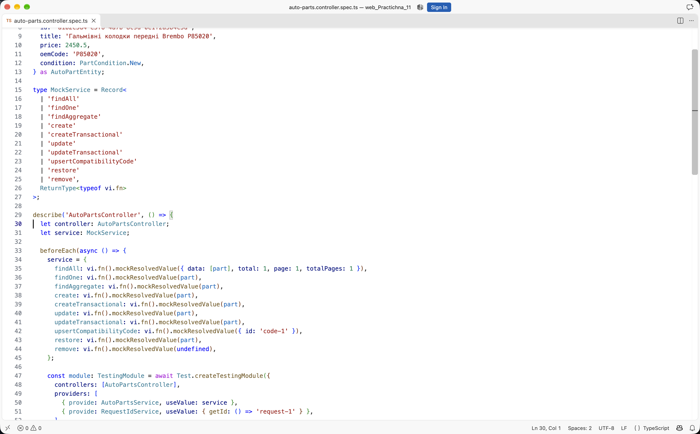

Аналогічний тестовий модуль створено для `CatalogController` і `CatalogService`, тому довідники також входять до звіту покриття.

#### Документування DTO

Усі поля вхідних моделей отримали `@ApiProperty` або `@ApiPropertyOptional` з описом, прикладом і типом. Для переліку стану деталі використано `enumName`, щоб у схемі був зрозумілий підпис:

```ts
@ApiProperty({
  description: 'Стан деталі: нова або відновлена',
  enum: PartCondition,
  enumName: 'PartCondition',
  example: PartCondition.New,
})
@IsEnum(PartCondition)
condition!: PartCondition;
```

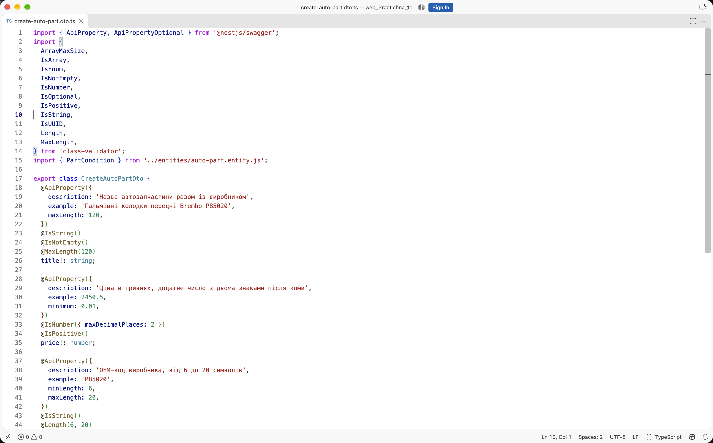

#### Документування маршрутів

Контролер позначено `@ApiTags('Автозапчастини та вузли')`. Для кожного методу додано `@ApiOperation` із коротким описом і `@ApiResponse` для можливих кодів. Закриті маршрути мають `@ApiBearerAuth()`:

```ts
@Roles(Role.Admin, Role.Mechanic)
@Post()
@HttpCode(HttpStatus.CREATED)
@ApiBearerAuth()
@ApiOperation({ summary: 'Створення нової запчастини' })
@ApiResponse({ status: 201, description: 'Запчастину додано до каталогу' })
@ApiResponse({ status: 400, description: 'Некоректні вхідні дані' })
@ApiResponse({ status: 401, description: 'Токен відсутній або недійсний' })
@ApiResponse({ status: 403, description: 'Недостатньо прав' })
@ApiResponse({ status: 404, description: 'Модель авто не знайдена' })
create(@Body() createAutoPartDto: CreateAutoPartDto) {
  return this.autoPartsService.create(createAutoPartDto);
}
```

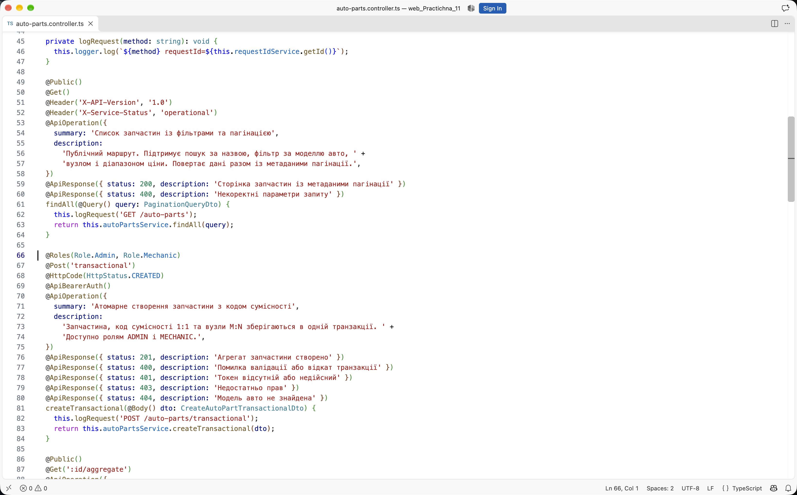

Розгорнутий маршрут `POST /auto-parts` показує приклад тіла запиту, обов'язковість полів і всі задокументовані відповіді.

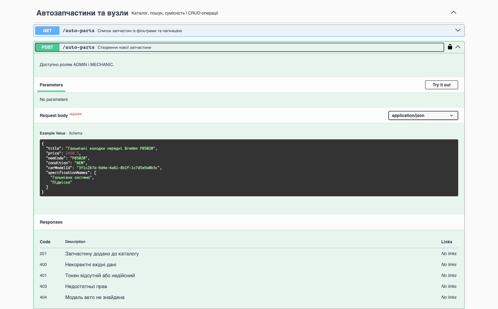

#### Покриття коду

Збір покриття налаштовано у `vitest.config.ts`. Для звіту обрано провайдер `v8`, текстову таблицю, HTML і lcov. Облік ведеться для модуля варіанта, тому DTO, модулі та сутності без бізнес-логіки виключені:

```ts
coverage: {
  provider: 'v8',
  include: ['src/auto-parts/**/*.ts'],
  exclude: ['src/**/*.spec.ts', 'src/**/dto/**', 'src/**/entities/**', 'src/**/*.module.ts'],
  reporter: [['text', { maxCols: 140, skipFull: false }], 'html', 'lcov'],
  reportsDirectory: './coverage',
}
```

Команда запуску:

```bash
npm run test:cov
```

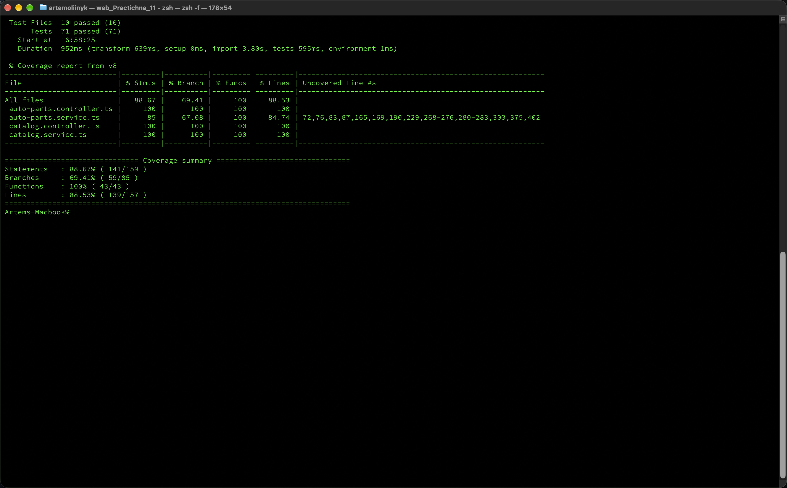

| Файл | Statements | Branches | Functions | Lines |
|---|---|---|---|---|
| `auto-parts.controller.ts` | 100% | 100% | 100% | 100% |
| `auto-parts.service.ts` | 85% | 67.08% | 100% | 84.74% |
| `catalog.controller.ts` | 100% | 100% | 100% | 100% |
| `catalog.service.ts` | 100% | 100% | 100% | 100% |
| **Разом** | **88.67%** | **69.41%** | **100%** | **88.53%** |

Детальний HTML-звіт відкривається з `coverage/lcov-report/index.html`. У ньому видно розподіл за файлами й непокриті рядки сервісу.

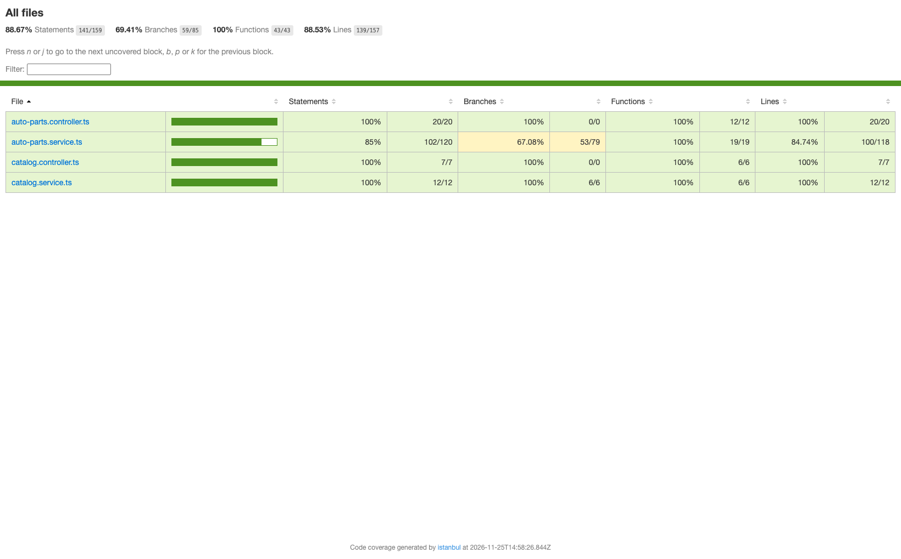

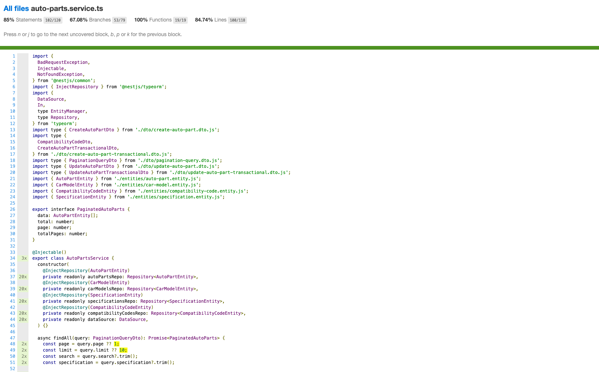

---

### Рівень 3. Наскрізні тести та експорт специфікації

#### E2E-тести

Файл `test/auto-parts.e2e-spec.ts` піднімає повний `AppModule`, підключає глобальні `TrimPipe`, `ValidationPipe` і фільтр виключень, після чого звертається до застосунку через `supertest`.

```ts
const moduleFixture = await Test.createTestingModule({ imports: [AppModule] }).compile();
app = moduleFixture.createNestApplication();
app.useGlobalPipes(
  new TrimPipe(),
  new ValidationPipe({ whitelist: true, forbidNonWhitelisted: true, transform: true }),
);
app.useGlobalFilters(new GlobalExceptionFilter());
await app.init();
```

Токен отримується реальним входом механіка через `POST /auth/login`, тому перевіряється весь ланцюжок авторизації, а не підставлений підпис.

Перевірені сценарії:

| Сценарій | Запит | Очікування | Результат |
|---|---|---|---|
| Публічний список | `GET /auto-parts?page=1&limit=5` | 200 і масив даних | успішно |
| Створення з JWT | `POST /auto-parts` + Bearer | 201 і збережений запис | успішно |
| Короткий OEM-код і від'ємна ціна | `POST /auto-parts` | 400 і масив повідомлень | успішно |
| Без токена | `POST /auto-parts` | 401 | успішно |

```ts
const response = await request(app.getHttpServer())
  .post('/auto-parts')
  .set('Authorization', `Bearer ${mechanicToken}`)
  .send(payload)
  .expect(201);

expect(body.oemCode).toBe(payload.oemCode);
expect(body.carModel.id).toBe(carModelId);
```

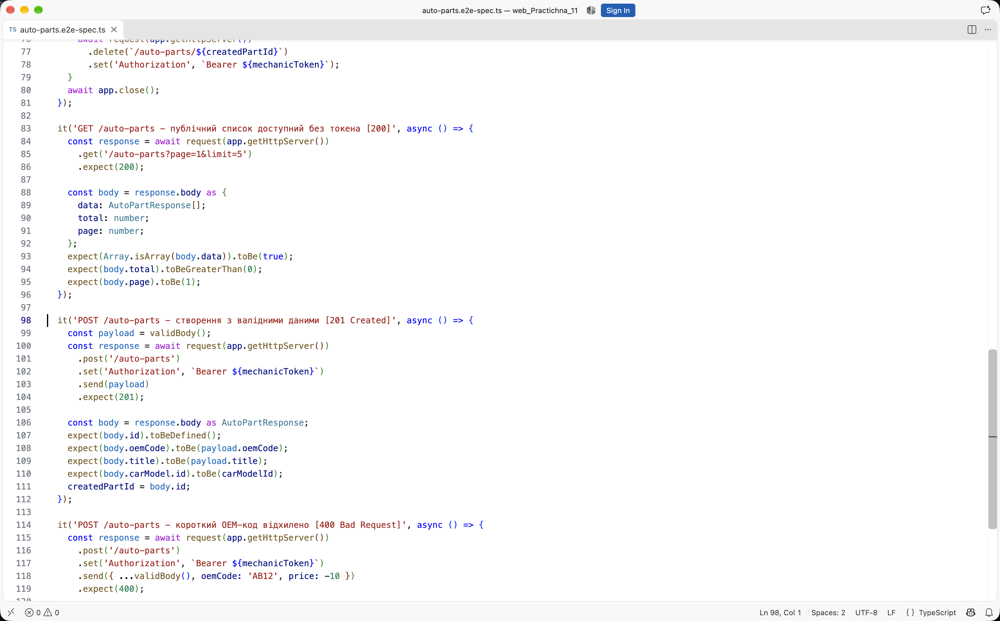

Окремо перевіряється негативний сценарій. Для варіанта 7 це короткий OEM-код, додатково - від'ємна ціна:

```ts
.send({ ...validBody(), oemCode: 'AB12', price: -10 })
.expect(400);

expect(body.success).toBe(false);
expect(body.message.join(' ')).toMatch(/oemCode/);
expect(body.message.join(' ')).toMatch(/price/);
```

Після створення запис видаляється через `DELETE`, тому повторний запуск тестів не накопичує тестові дані.

#### Перевірка документації та авторизації

У Swagger UI натискаємо **Authorize**, вставляємо access-токен, отриманий під час входу, і виконуємо захищений запит. Кнопка блокування біля маршруту показує, що токен застосовано.

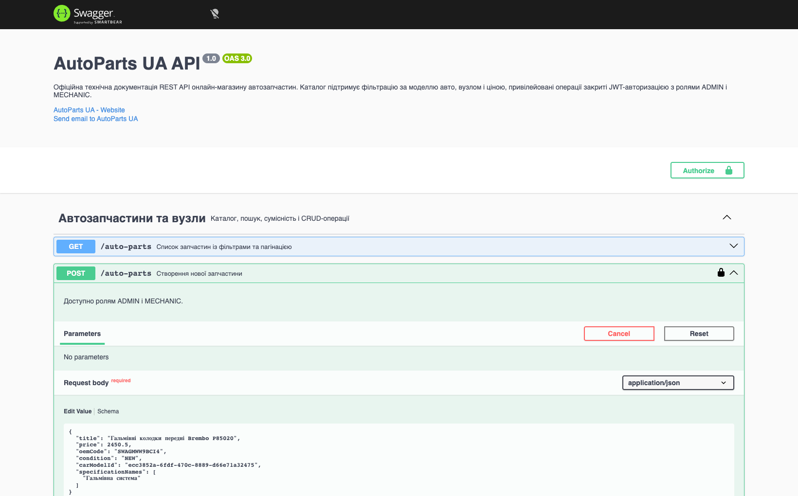

Відповідь на `POST /auto-parts` з реальним JWT повертає код 201 і повний об'єкт запчастини разом із моделлю авто та вузлами.

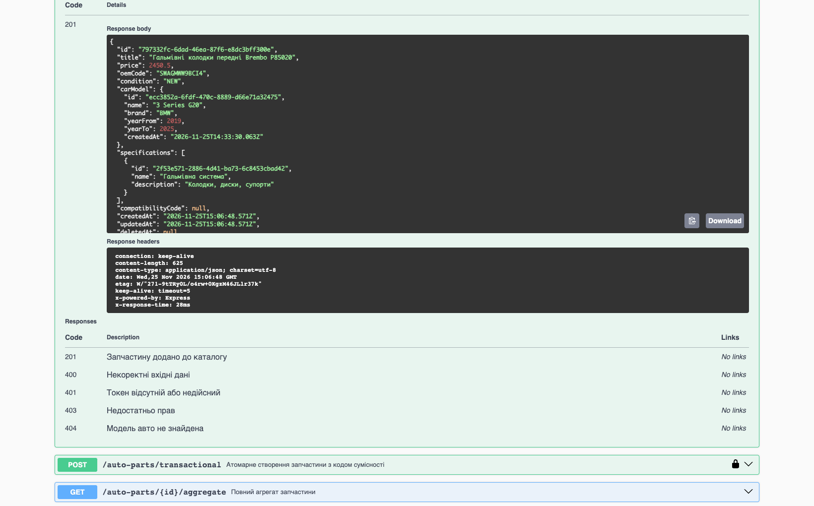

Публічний `GET /auto-parts` із фільтрами повертає 200, сторінку даних і службові заголовки `X-API-Version` та `X-Service-Status`.

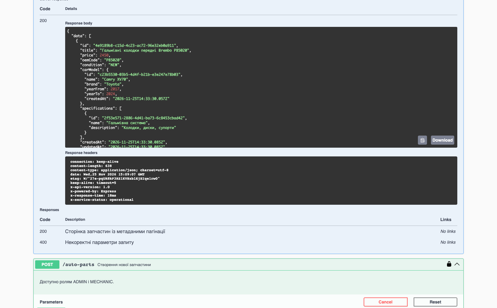

#### Експорт OpenAPI

Специфікація у форматі JSON доступна за адресою `/api/docs-json`. У ній присутні 22 маршрути, три тематичні розділи та схема безпеки `bearer` типу `http` із форматом `JWT`.

---

## Результати перевірки

| Перевірка | Команда | Результат |
|---|---|---|
| Модульні тести | `npm run test` | 10 файлів, 71 тест, усі пройшли |
| Покриття | `npm run test:cov` | 88.67% statements, 88.53% lines |
| E2E-тести | `npm run test:e2e` | 2 файли, 5 тестів, усі пройшли |
| Збірка | `npm run build` | без помилок |
| Swagger UI | `GET /api/docs` | 200, сторінка генерується |
| OpenAPI JSON | `GET /api/docs-json` | 200, 22 маршрути |

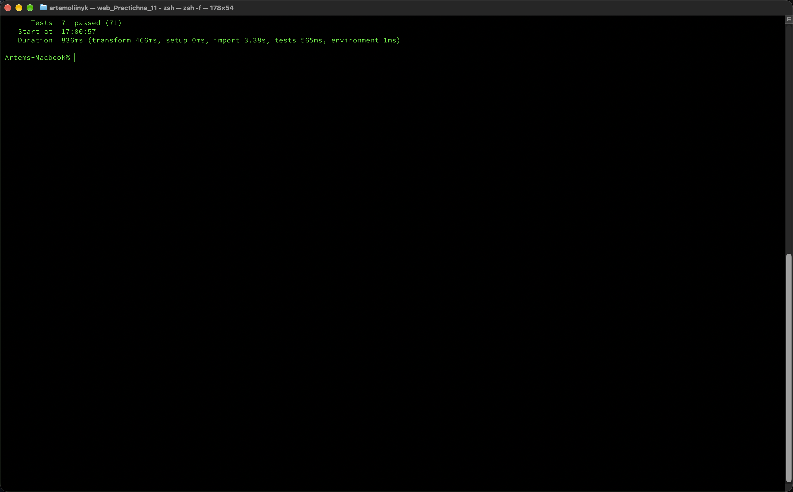

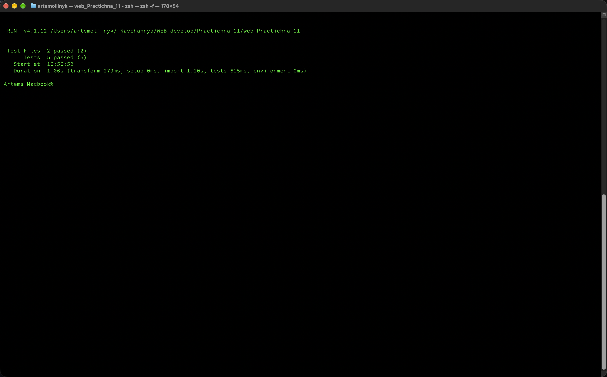

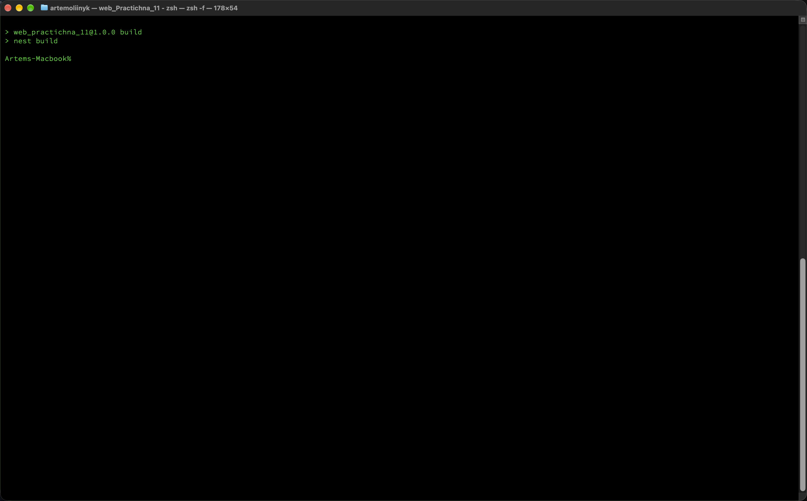

---

## Інструкція запуску

```bash
npm ci
cp .env.example .env
docker compose up -d
npm run migration:run
npm run seed
npm run start:dev
```

Після старту:

- Swagger UI: `http://localhost:3000/api/docs`
- OpenAPI JSON: `http://localhost:3000/api/docs-json`
- PostgreSQL: `localhost:5435`, база `auto_parts_p11`
- Тестовий механік: `mechanic@autoparts.local` / `Mechanic12345`
- Тестовий адміністратор: `admin@autoparts.local` / `Admin12345`

Перевірка тестів:

```bash
npm run test
npm run test:cov
npm run test:e2e
```

---

## Висновки

- Модульні тести з моками дозволяють перевіряти бізнес-логіку сервісу без підключення до PostgreSQL. Кожен тест ізольований і не залежить від стану бази.
- Тестування контролера через `Test.createTestingModule()` підтверджує, що маршрути передають у сервіс саме ті аргументи, які очікує бізнес-логіка.
- E2E-тести через `supertest` перевіряють весь конвеєр: валідацію, глобальні гарди, контролер, сервіс і базу даних. Це дало змогу побачити різницю між помилкою валідації 400, відсутністю токена 401 і успішним створенням 201.
- Покриття 88.67% за statements і 100% за функціями показує, що основні гілки сервісу перевірені. Непокриті рядки залишилися в рідкісних комбінаціях транзакційних оновлень.
- `@nestjs/swagger` будує документацію з тих самих декораторів, які використовуються для валідації, тому схема й код не розходяться. Кнопка Authorize дає змогу перевіряти захищені маршрути без окремого HTTP-клієнта.
- Найбільше часу зайняла підготовка ізольованих моків для транзакційних методів: `dataSource.transaction()` довелося замінювати функцією, яка одразу викликає переданий колбек із підставним `EntityManager`.
